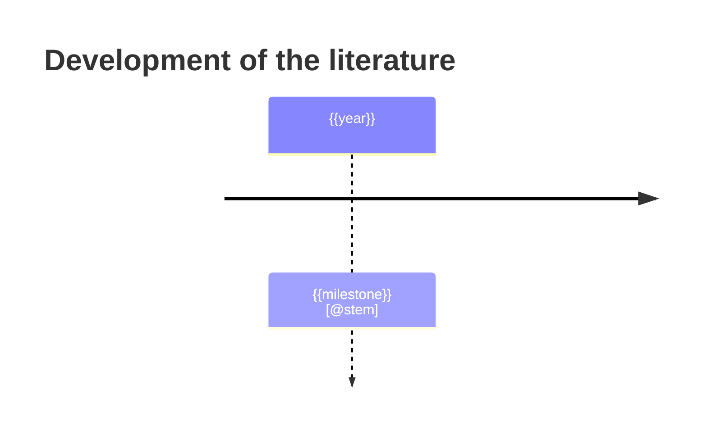
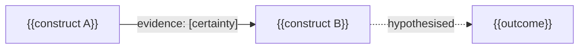

# {{title}}

*Scoping/mapping meta-survey of the literature on: {{topic}}*
*Run `{{run_dir}}` | Corpus snapshot: {{date}} | Protocol (frozen, v{{protocol_version}}): [protocol.md](protocol.md) | Scope: [scope.md](scope.md)*

<!--
GUIDANCE (delete this comment before audit.py; it is stripped for checks but flagged as leftover)
Reporting standards this template carries: PRISMA 2020 (items cited as P01 item N) + PRISMA-S (search) + PRISMA-ScR
(scoping vocabulary: "sources of evidence", "charting") [P01, P02, P04, P08]; SWiM items for quantitative synthesis
without meta-analysis [S01]; qualitative reporting in the spirit of ENTREQ/eMERGe/RAMESES (methods appendix) [S12, S11];
AI-use statement per PRISMA 2020 automation items [P01 items 8, 9, 11, 14, 15] and the joint AI position [P24 AB].
CITATION CONVENTION (enforced by scripts/audit.py)
- Inline [@stem] or [@stemA; @stemB, p. 4]; stem = home-still catalog stem (DOI with / -> _). Never cite from memory.
- Quotes: verbatim, in "double quotes" or a > blockquote, with [@stem] in the same paragraph.
- Certainty label on every key finding: High / Moderate / Low / Very low, naming the framework (GRADE for effect
  findings, GRADE-CERQual for qualitative/interpretive findings); no numeric quality scores; no "k of n significant" tallies.
- Abstract-only evidence is marked "(abstract-only)" at the point of use. Unresolved metadata prints as UNRESOLVED (refs.py).
- The References block is generated: scripts/refs.py --write.
-->

## Abstract

<150-250 words, PRISMA-2020-abstract style: objective; sources searched and dates; number of sources of evidence screened/included/deep-read; synthesis methods; headline findings with certainty; premise verdict; the central non-obvious insight; main limitation incl. AI use; protocol/registration statement.>

## Key findings

| # | Finding (explicit proposition) | Logic | Certainty (framework) | Why this certainty | Main support |
|---|---|---|---|---|---|
| 1 | | aggregative / configurative | High / Moderate / Low / Very low (GRADE / GRADE-CERQual) | <each rating-down reason once; no double counting> | [@stem] |

**Premise verdict.** <supported / partly supported / unsupported / ill-posed - with the strongest evidence for and against, and the rival accounts weighed.>

## 1. From the question to constructs

### 1.1 The question and its hidden premises
<restate; list implicit premises as falsifiable claims>

### 1.2 Concept map (PCC) and construct ledger
| Construct | What the everyday phrase maps to | Operational measures actually used (ledger groups) | Informant | Fields | Core papers |
|---|---|---|---|---|---|

### 1.3 Premise check
<disconfirming evidence sought and found; stereotype/stigma critiques; perspectives of the studied group; reversed / third-variable / interactional accounts>

## 2. Methods

### 2.1 Review design and protocol (P01 items 4, 24a-c; P08)
<review type and why (scoping/mapping with systematic search; link to P11 purposes); PCC question; logic per RQ (aggregative/configurative); protocol frozen before the first external search (version, date, SHA-256 from protocol.md); amendments (list each, or "none"); registration: not registered, protocol file + hash is the record.>

### 2.2 Information sources and search (PRISMA-S; P01 items 6-7)
<every source listed separately (home-still corpus, each paper_search provider, local OpenAlex BM25, citation chasing); date of each search; number of queries by construct; full queries in `corpus/search-log.tsv` and `queries/*.txt`; seed set and **seed-recall validation result**; strategy peer-review (PRESS elements, second-agent substitute); limits (no Boolean/subject-heading control, provider coverage, paywall); de-duplication method. Citation chasing: base articles, direction, platform, date, rounds and yield per round, stop rule (`corpus/snowball-rounds.tsv`).>

### 2.3 Selection of sources of evidence (P01 items 8, 16a-b)
<pilot; two independent agent passes (prompts/models); err-toward-inclusion rule; agreement: raw, Cohen's kappa, PABAK (from `corpus/screening-stats.json`); adjudication; recall audit result; full-text exclusion reasons; tiering rule (core/adjacent/background); acquisition outcomes (full text / abstract-only / unconvertible).>

{{prisma_flow_mermaid}}
<!-- Paste scripts/flow_counts.py output (flow.mmd). Numbers come from files, never typed by hand. -->

| Stage | n |
|---|---|
| Records identified (sources / citation chasing) | |
| After de-duplication | |
| Screened (two independent passes) | |
| Excluded at title/abstract (reasons: see appendix B) | |
| Sought for full text / not retrieved | |
| Excluded on full text (reasons) | |
| Full text in corpus; abstract-only; unconvertible | |
| Deep-read with structured notes | |
| Cited in this report | |

### 2.4 Data charting and verification (P01 item 9; P08 charting)
<schema = paper-note template; pilot on 2 papers; **quote-or-null** rule; verification pass (`verify_notes.py` result: FAIL/WARN counts); human spot-check sample size and error found; construct ledger and informant coding.>

### 2.5 Critical appraisal (P01 items 11, 18; optional in PRISMA-ScR, done here by design - see protocol section 1)
<tool by design (table in protocol section 9); domain-level, per finding, quote-or-NI; **no summed score**; which tools were only partly applied because the reference lacked their item lists; sensitivity analysis excluding inadequately reported studies and what it changed.>

### 2.6 Synthesis methods (SWiM items 1-9 [S01]; qualitative methods named [S02, S08-S14])
<Per stream: grouping and why (1); metric (2); method and why - SWiM narrative / thematic / best-fit / CIS / realist CMO / meta-narrative (3); prioritisation criteria (4); heterogeneity exploration, flagged post-hoc (5); certainty method (6); display (7); limitations (9). Integration method: convergent segregated/integrated, joint display, fit labels [S18, S21]. State that any direction-of-effect tally answers "is there any evidence of an effect?", not "what is the average effect?".>

### 2.7 Certainty of evidence (P01 items 15, 22)
<GRADE for effect findings (start, down/up reasons); GRADE-CERQual for qualitative findings (four components, concern levels, written reasons); two independent assessments + reconciliation; no numeric scores; no double downgrading. Per-finding records: `synthesis/certainty.md`.>

### 2.8 Use of AI and automation (P01 items 8, 9, 11, 14, 15; P24 AB; P36 AB proposal)
<Which steps used LLM agents (query generation, screening passes A/B, extraction, appraisal drafts, synthesis drafting); model/tool names and versions; prompts archived (`synthesis/ai-use-log.md`); validation performed (kappa/PABAK, recall audit, verification pass, citation audit); human oversight and accountability checkpoints. **Disclosure: two LLM screening passes are not shown to be equivalent to two human screeners [P38 AB, P39 AB]; single-pass screening misses ~13% of relevant studies [P28 AB] and humans err too [P29].** Reference integrity: every citation resolves to a catalog/OpenAlex/provider record and was checked by `audit.py`; LLM-recalled references were treated as leads only [P26 AB, P27 AB].>

## 3. Landscape

### 3.1 Fields and where the evidence lives
| Field / research tradition | Typical designs | Conceptualisation of the topic | n core | Notes |
|---|---|---|---|---|

### 3.2 Timeline

### 3.3 Who was studied and who is speaking
<populations, diagnostic methods, sex/gender composition, age, IQ range, geography; informant mix (self-report / family / clinician / task); what is systematically missing; autistic-authored and community-priority sources included and labelled.>

### 3.4 Characteristics of included sources
<table of core papers: design, N, population, dx method, measures, appraisal summary, link to note. (PRISMA 2020 item 17; PRISMA-ScR charting results)>

## 4. Thematic findings

<!-- One block per theme (research question / construct cluster). Remove this comment. -->

### 4.x {{theme title}}

**Bottom line (certainty: ...; framework: ...).** <2-3 sentences stating the proposition explicitly.>

**Evidence table**
| Study | Design / N | Population & dx method | Informant | Measure (ledger group) | Result (direction, effect size, CI) | Appraisal | Location |
|---|---|---|---|---|---|---|---|
| [@stem] | | | | | | | p. |

**Convergence.** <where independent samples and methods agree, and why that is credible>
**Divergence and refutational translation.** <contradictions explained by population, setting, measure/construct definition, design or time; or "different construct under the same name" (measurement insight)>
**Counter-evidence sought.** <queries tried and what they returned, or "none found + queries tried">
**Interpretation.** <meaning for the question; limits; first-/second-/third-order labelling (whose interpretation)>

## 5. Integrative model

<Separate what is evidenced from what is hypothesised. The model is a line-of-argument built from synthetic constructs; label every edge's certainty and whose interpretation it is.>

### 5.1 Synthetic constructs
| Construct (defined) | Second-order constructs it absorbs (stems) | What it adds beyond the studies | Status |
|---|---|---|---|

### 5.2 Links, certainty and rivals
| Link | Evidence status | Certainty | Supporting / contradicting stems | Alternative explanation |
|---|---|---|---|---|

### 5.3 Mechanism claims (context-mechanism-outcome)
| Context | Mechanism (whose reasoning/resources) | Outcome | Supporting stems | Contradicting stems | Middle-range theory |
|---|---|---|---|---|---|

### 5.4 Competing theoretical accounts (adjudicated on the same evidence)
| Account | Predicts | Data accommodated | Data unaccommodated | Integrity problems | Verdict |
|---|---|---|---|---|---|

### 5.5 Joint display: quantitative x qualitative streams
| Proposition | Quantitative stream (certainty) | Qualitative stream (certainty) | Fit: confirmation / expansion / discordance | Explanation |
|---|---|---|---|---|

## 6. Tensions and contradictions
<each: the two positions, the papers, why they differ (measurement? sample? definition? informant? matched vs mixed dyads?), what would settle it; discordant cells from 5.5 and how they were handled>

## 7. Methodological critique of the field
<diagnostic heterogeneity; self-report vs behaviour; male-skewed and verbally fluent samples; co-occurring conditions; construct overlap between instruments (construct ledger); small N, low power, analytic flexibility, replication status [S28-S30]; publication-bias signals and how missing results were sought; cross-sectional causal language (causal-wording gate); deficit-framed designs; whether the studied group shaped the questions; tools of appraisal that were only partly applicable.>

## 8. Deep insights

<The interpretive layer. Each insight: claim, evidence chain (cited), what it reframes, how it could be wrong, testable prediction, status. Quality criteria checked: every edge cites stems and says whose interpretation; >= 1 rival with evidence for/against; disconfirming cases listed; synthetic construct defined; certainty per proposition with the weakest link named; reasoning type labelled aggregated vs configured.>

### 8.x {{insight title}}
- Claim:
- Evidence chain (cited):
- Reasoning type: aggregated (data-based) | configured (reviewer-linked)
- Reframing (is the field's unit of analysis wrong?):
- Rival explanations and evidence for/against:
- How it could be wrong:
- Testable prediction (what would falsify it):
- Status: evidence-derived | inference | speculation

## 9. Gaps and research agenda
| Gap | Why it matters | Suggested design | Feasibility |
|---|---|---|---|

## 10. Practical implications (careful)
<Only what the evidence supports, with certainty attached. State what the evidence does NOT license. No clinical or diagnostic advice.>

## Limitations of this synthesis
<search limits (provider coverage, paywall: abstract-only items listed); unresolved-metadata items; appraisal tools partly applied; LLM-specific limits (screening non-equivalence, residual confabulation risk, grounded-but-unverified claims); no community co-production - **this synthesis is a literature product made without community co-production; corrections from autistic readers and researchers are invited** (include for autism-touching topics) [S31]; deviations from protocol; what was not read.>

## Reporting checklists
| Standard | Where addressed |
|---|---|
| PRISMA 2020 (27 items; P01) | Abstract; §2.1 (4, 24a-c); §2.2 (6, 7); §2.3 (8, 16a-b); §2.4 (9); §2.5 (11, 18); §2.6 (13); §2.7 (15, 22); §3.4 (17); App. A-D; data availability (27) |
| PRISMA-S (16 items; P04) | §2.2, App. C, `corpus/search-log.tsv` |
| PRISMA-ScR (P08: "sources of evidence", charting) | §2.1-2.4, §3 |
| SWiM (9 items; S01) | §2.6, §4 |
| Qualitative synthesis reporting (S12, S11) | §2.6, §5, App. E |
| AI-use reporting (P01 automation items; P24 AB) | §2.8 |

## Appendices

### A. Evidence matrix (research question x study)
| Paper | RQ1 | RQ2 | RQ3 | Design | Appraisal | Informant |
|---|---|---|---|---|---|---|
| [@stem] | + / - / 0 / mixed | | | | | |

### B. Corpus list and exclusions
<core / adjacent / background with tier rationale; **excluded at full text with reason per record** (PRISMA item 16b); title/abstract exclusion counts by reason; abstract-only and unresolved items flagged; not-retrieved list.>

### C. Search log summary and strategy validation
<queries by construct and provider with dates and hit counts; seed recall; snowball rounds and yield; link to full logs.>

### D. Certainty records and SWiM items
<per-finding certainty records (GRADE profile or CERQual evidence profile); SWiM item table per synthesis.>

### E. Qualitative synthesis detail
<descriptive -> analytical themes or framework table; reciprocal/refutational translation notes; sensitivity analysis results.>

### F. References
<!-- REFS:BEGIN -->
<!-- REFS:END -->
